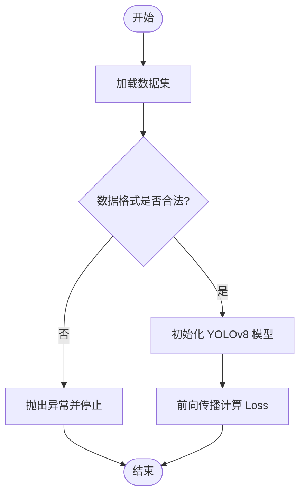
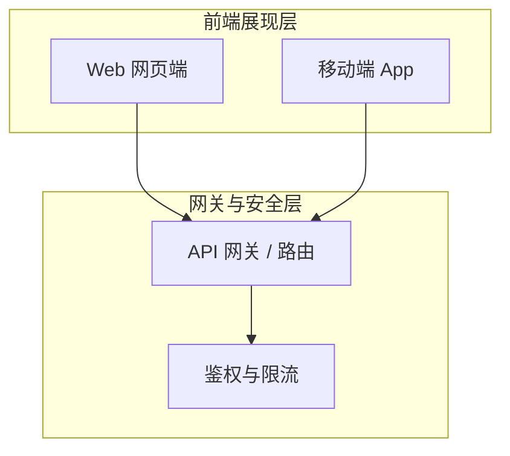
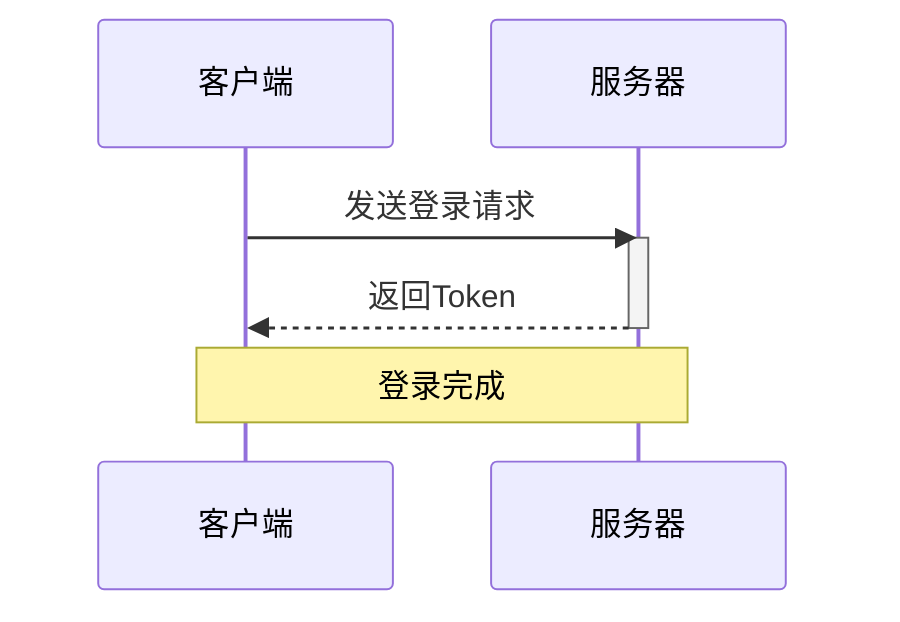

 # 0 内联代码
单反引号+内容，强调用文本体现，没有语法等，如
`这是*`
3个单反引号+内容，可以表示多行源代码
第一个单反引号后面加代码语言，如c/c++/js，可实现高亮 ^38003f
```c
printf('hello world!')
```

^185e5b


# 1 标题
以“#+空格+标题内容”表示，最多七级标题，如下
# 一级标题
## 二级标题
### 三级标题
#### 四级标题
##### 五级标题
###### 六级标题
###### 七级标题

# 2 斜体/加粗
文字前后加1~3个星号，快捷键shift+8，如，
`*斜体*`表示为*斜体*
`**加粗**`表示为**加粗**
`***加粗斜体***`表示为***加粗斜体***

# 3 高亮
文字前后加2个等号，快捷键shift+=，如
`==高亮==`表示
==高亮==

# 4 删除
文字前后加2个~，快捷键shift+~，如
`~~删除该文字~~`
~~删除该文字~~

# 标签

以“#+标题内容”表示
#这个是标签
支持子标签，后面加斜杆
`#父标签/子标签`
#小米/汽车
#小米/电饭锅
注：标签支持字符/数字/下划线/连字符/斜杆，但不能是纯数字，不区分大小写，不能加空格，

# 5 链接
## 5.1 文件链接/网址链接
markdown 通用格式：文字前后加单个中括号+小括号，
中括号内写标签，小括号内写指向的文件名称或者网页地址等，名称不能有特殊符号。如
`[语法](1.语法.md)`
[语法](1语法.md)
注：如有特殊字符时，在小括号内加尖括号
`[语法](<1.语法.md)>`
[语法](<1语法.md>)

wikilink 格式，obsidian专属
文字前后加2个中括号，快捷键shift+括号，如
`[[1语法]]`
这是一个[[双链]]

## 5.2 附件链接

方式1：直接拖拽
方式2：格式`![[下载.webp]]`或者``
![[下载.web]]


## 5.3 文件内容引用
文件后面加#标题
文件后面加#^内容
`[[1语法#0 内联代码]]`
[[1语法#0 内联代码]]
`[[1语法#^185e5b]]`
![[1语法#^185e5b]]
> [!标注]+ [[]]前面加感叹号，可直接显示内容

# 6 图片渲染
感叹号+单个中括号+单个小括号，
中括号内写外部图片，小括号内写指向图片地址
``

注：可采用图片上传云端，然后提供图地址，减少md存储空间

# 7 引用
大于号+空格+引用内容，如
`> 勇敢的人先享受世界。--鲁迅`
> 勇敢的人先享受世界。--鲁迅

# 8 标注
大于号+空格+中括号(第一个是感叹号+关键字段)+内容
注：括号后面加+或者-可实现折叠或者展开
注：多个>实现嵌套
`> [!标注]+ 这是一个标注`
> [!标注]+ 这是一个标注
> 勇敢的人先享受世界的作者是鲁迅。
> > [!Abstract]+ 这是一个概要
> > > 鲁迅是名人。

> [!Note] 笔记

> [!Abstract] 概要

> [!Info] 内容

> [!Todo] Todo

> [!Tip] 标签

> [!Success] 成功

> [!Question] 疑问

> [!Warning] 警告

> [!Failure] 错误

> [!Danger] 危险

> [!Bug] 漏洞

> [!Example] 举例

> [!Quote] 

# 9 列表

无序列表：减号+空格+内容，Tab是缩进，如
`- 列表1`
- 列表1
- 列表2
	- 列表2.1

有序列表： 数字+点+空格+内容
缩进+ 数字+点+空格+内容
`1. 列表1`
1. 列表1
2. 列表2
	1. 列表2.1

任务列表：减号+空格+中括号+空格+列表内容，
中括号内加空格表示未完成，`- [ ] 任务列表1`
中括号内加x表示完成并以删除线表示，`- [x] 任务列表2`
中括号内加y表示完成，`- [y] 任务列表2`
- [ ] 任务列表1
- [x] 任务列表2
- [y] 任务列表2

有序任务列表
1. [ ] 列表1
2. [x] 列表2
	1. [y] 列表2.1
	2. [ ] 列表2.2

# 10 分割线

3个减号
`---`

---

> [!标注]+ 区别笔记属性和分割线，笔记属性是在第一行3个减号表示，而分割线是在正文里添加3个减号

# 11 脚注


插入脚注，
方式1：使用Ctrl+P，输入脚注，填写内容，
方式2：中括号，括号内^+数字表示，`[^2]`
如
脚注1[^1]
脚注2[^2]

[^1]: 这是一个脚注
[^2]: 这是第二个脚注

注：需先填写脚注内容，格式为`[^1]: 脚注内容`

# 12 注释
2个%+注释内容+2个%，如
`%%这是注释，阅读模式不会显示内容%%`
%%这是注释，阅读模式不会显示内容%%

# 13 符号
每个符号前面加反斜杆，不会被Markdown语法渲染，如
\*\*
\%\%
\`\`

# 14 表格

|项目|内容|
|---|---|
|项目1|内容1|
|项目2|内容2|

> [!标注]+ markdown自带的表格不支持自动计算、合并等操作，如需使用，可使用插件

# 15 图表
## 流程图

## 架构图


## 时序图


# 数学公式
单号以一个$里填写公式

$E = mc^2$

多行以两个$里填写公式
$$
E = mc^2
$$

# 视频
markdown对国内网址 视频渲染差，最好以html格式书写，或者用第三方插件
```
<iframe src="https://www.bilibili.com/video/BV1Pg4y1H71v/"></iframe>
```

国外，``
